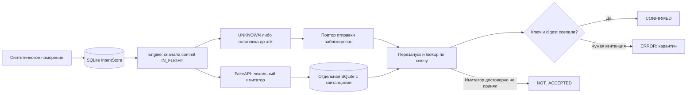

# Синтетическое демо: что делать, если ответ потерян

**Отдельная оригинальная демонстрация v0.1.0.** Python 3.12+, только стандартная библиотека. Рабочие исходники четырёх роботов сюда не переносились. Демо сохраняет вымышленный образец `SYNTHETIC-SAMPLE` в локальном имитаторе API. Сети, счетов, ключей, торговых параметров и торговой логики нет.

Задача: отправитель не получил подтверждение. Имитатор мог уже принять запрос, а мог не принять его. Немедленный повтор опасен для систем с внешними эффектами. Демо сначала сохраняет намерение и границу отправки, после перезапуска сверяет исход по ключу и проверяет соответствие ответа намерению.

## Запуск

Из корня публичного комплекта, где находится папка `demo`:

```console
python -m demo.run
python -m demo.run --output demo/reports
python -m unittest discover -s demo/tests -v
python -m demo.checks --output demo/reports
```

Первая команда выводит краткий JSON и использует временные файлы; постоянных отчётов она не создаёт. `--output` явно сохраняет только `report.json` и `trace.jsonl`. Обе SQLite-базы всегда временные и удаляются при штатном завершении. При аварийном завершении самого процесса стандартная временная папка может остаться на диске.

`demo.checks` запускает только тесты этой демонстрации. Без `--output` его отчёты тоже временные. Для корректного учёта импортов запускайте его отдельной командой в новом процессе. Внешние библиотеки и установка пакетов не нужны.

Ожидаемый итог запуска v0.1.0:

```json
{"events": 29, "passed": true, "reports_saved": false, "scenarios": 5, "synthetic": true, "version": "0.1.0"}
```

## Устройство



`core.py` содержит контракт, неизменяемые записи, автомат состояний и сверку. `fake_api.py` — локальную модель внешнего эффекта с отдельным хранилищем. `run.py` собирает пять сценариев и безопасный след событий. Ключи имеют префикс `SYN-KEY-`, намерения — `SYN-INTENT-`, квитанции — `SYN-RECEIPT-`; реальные идентификаторы не используются.

| Сценарий | Сбой / событие | Проверяемый результат |
|---|---|---|
| `accepted_unknown` | Имитатор принял запрос, ответ потерян | После закрытия и открытия обеих БД: сверка → `CONFIRMED`; только одна отправка |
| `rejected_unknown` | Имитатор не принял запрос, ответ потерян | Сверка → `NOT_ACCEPTED`; повтор не выполняется |
| `restart_before_ack` | Принятие уже произошло; выполнение остановлено до местного ack | Сохраняется `IN_FLIGHT`; после восстановления только сверка; повторная квитанция не меняет состояние |
| `foreign_key_mismatch` | Пришла квитанция другого ключа | `ERROR`; подтверждение и повторная отправка заблокированы |
| `corrupt_state` | Сохранённое состояние намеренно испорчено | Открытие хранилища запрещено; API даже не создаётся |

Повторная доставка квитанции также проверяется в первом сценарии. Тесты дополнительно проверяют неправильный digest, неизвестное намерение, невозможность сбросить конечное состояние в `PREPARED`, отказ сверки, неожиданный сбой адаптера после приёма, подмену payload, неизвестную версию схемы и нечитаемую БД.

## Результат проверки: только это демо

Прогон 15.10.2026, Python **3.12.14**: **31 тест, 0 ошибок, 0 неудач, 0 пропусков**. Статус: `VERIFIED_RUNTIME` для синтетической демонстрации. Исходные проекты не запускались.

| Область | Исполнено / исполняемых строк | Line coverage |
|---|---:|---:|
| `demo/core.py` | 176 / 178 | 98,88% |
| `demo/fake_api.py` | 35 / 35 | 100,00% |
| Всего в указанной области | 211 / 213 | **99,06%** |

Инструмент: стандартный `trace.Trace`; знаменатель — номера исполняемых строк из рекурсивного `dis.findlinestarts`, включая выполнение определений при импорте. Это измерение строк, **branch coverage не измерялось**. `run.py`, `checks.py` и тестовый код не включены в процент; сценарии `run.py` проверены интеграционными тестами. Два неисполненных защитных пути: неуспешный результат `PRAGMA integrity_check` у всё ещё читаемой БД и изменение строки между чтением и условным обновлением. Нечитаемая БД проверена отдельным тестом; это другой путь.

Полный машинный результат и SHA256 точных файлов: [coverage.json](reports/coverage.json). Протокол: [test-results.txt](reports/test-results.txt). Построчная разметка: [core](reports/core.py.cover.txt), [fake API](reports/fake_api.py.cover.txt). Покрытие зависит от версии Python и этих исходников; его нельзя переносить на роботов или трактовать как гарантию надёжности.

## Доказательства сценария и границы модели

[report.json](reports/report.json) содержит проверки пяти сценариев и массив `trace`; [trace.jsonl](reports/trace.jsonl) — тот же след по одному событию в строке. Поля события: `seq`, `scenario`, `event`, `intent_id`, `idempotency_key`, `state`, `details`. В этих отчётах нет времени и случайных ID: повторный запуск даёт одинаковое содержимое. Дата и окружение фактического тестирования указаны отдельно в отчёте покрытия.

Браузерное воспроизведение этого следа — иллюстрация синтетических событий. Оно не выполняет Python, не подключается к API и не является дополнительным тестом серверного кода.

Остановка до ack моделируется исключением в определённой точке с последующим закрытием и открытием БД. Это проверка восстановления состояния, а не испытание отключением питания или завершением процесса операционной системой. `synchronous=FULL` — настройка SQLite, не доказательство аппаратной долговечности.

У имитатора есть полный и согласованный журнал квитанций: отсутствие ключа означает, что он не принял запрос. Для реального API с задержкой появления данных такой вывод может быть неверен; нужны документированный контракт идемпотентности и отдельная политика неопределённости. Демо не делает автоматическую новую отправку даже после `NOT_ACCEPTED` и не обещает «exactly once» во внешней распределённой системе. Проверка ключа и digest предполагает доверенный имитатор, не заменяет аутентификацию реального сервиса.

Восстановление и сверка начинаются **после остановки прежнего отправителя**. Одновременные `dispatch` и `reconcile` в разных процессах не моделируются: чтение до завершения отправки могло бы преждевременно увидеть отсутствие квитанции. Это последовательный демонстратор, а не протокол конкурентной координации.

Процент тестового покрытия, количество сценариев и код в этой папке относятся только к демонстрации v0.1.0. Метрики DARNeuroX, DARTherapeX, DARCardioX и Koshka представлены в витрине отдельно с собственными источниками.
