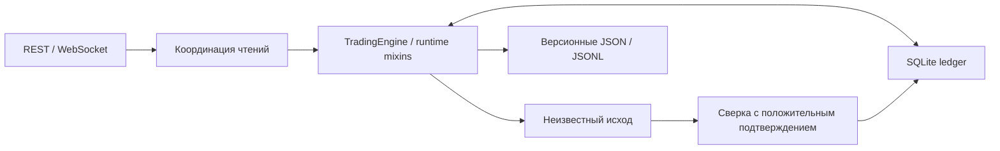
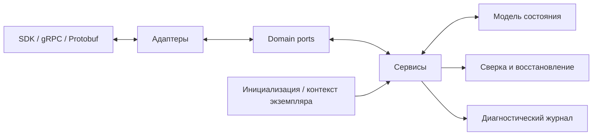
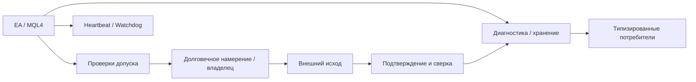
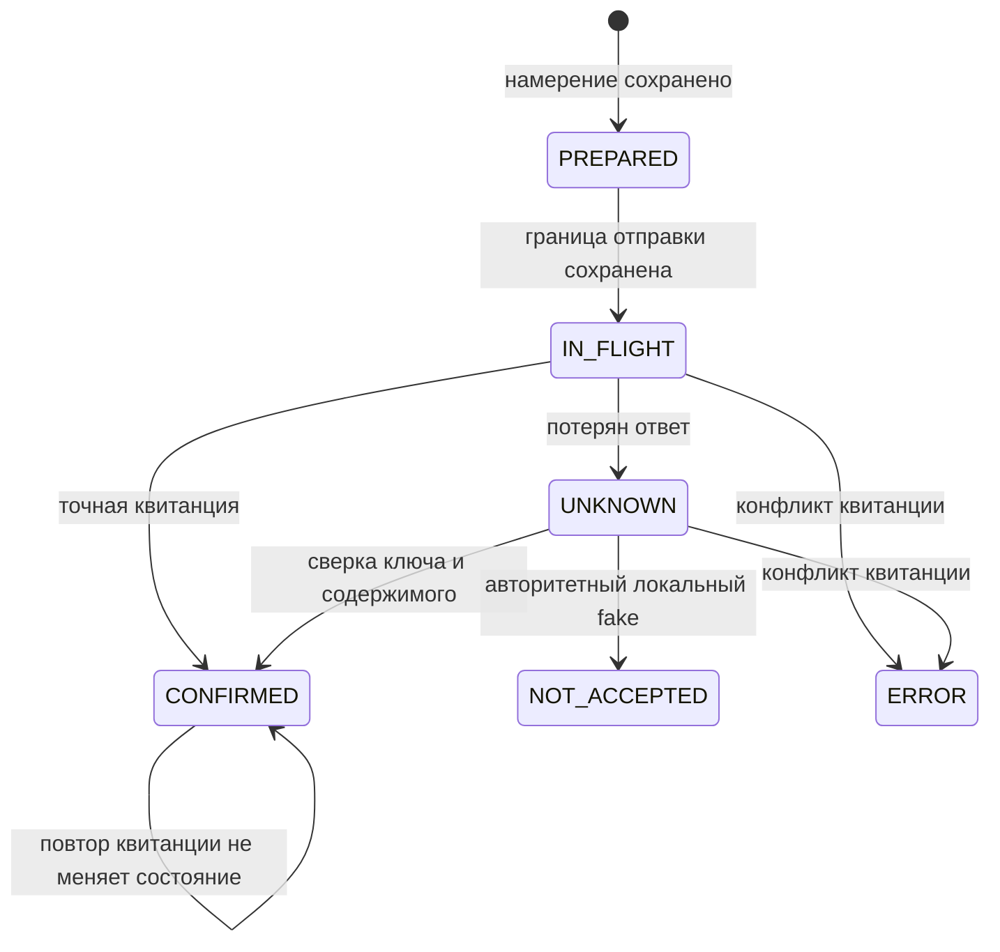

# Архитектура, развитие и диагностика

[На главную](../README.md) · [Реестр доказательств](evidence.md)

Схемы ниже — обезличенное описание установленных связей, без торгового ядра и параметров. Они не заменяют runtime-испытание. Версии и источник каждого вывода закреплены в реестре.

## DARNeuroX

Статически проверены Python runtime, REST/WebSocket-интеграция, координация чтений и SQLite-учёт. Карта активного пути описана в CodeX_active_path_v.2.4.md, закреплённый результат тестирования — отдельно для релиза 2.6; эти две области не смешиваются. [N26-* и источники N-ARCH/N-ENGINE/N-IO](evidence.md#neuro).

Инженерная трудность — не считать пустую историю доказательством отсутствия внешнего действия, связывать данные с правильной областью, сохранять историю при обновлениях и контролировать владельца процесса. Сохранённый синтетический стенд 2.6 и его 790 instrument/bar описаны отдельно от live API и от нового демонстратора.

## DARTherapeX

Снимок 30.02 от 13.10.2026: слои adapter, core, domain, facade, infrastructure, initializer, presentation, service; **39 domain port interfaces**. Декларации зависимостей: Java 17, T-Invest SDK 1.49.1, gRPC 1.78.0, Protobuf 4.31.1. Проверены подписи порта отправки/восстановления и отдельные компоненты сверки, контекста экземпляра и диагностики. [DTX-30-*](evidence.md#dart).

Паспорт 14.09.2026 документирует эволюцию от сценария/монолита к структуре: совместимость SDK/Protobuf, согласование состояния, устранение скрытых fallback-путей, систематические аудиты и разбор повторяющихся ошибок. Это историческое описание развития, не подтверждение выполнения каждой ветви в последующем выпуске. Статический срез 622/721 файлов не получает автоматически покрытие более раннего 488/274.

## DARCardioX

MQL4/MT4-робот взаимодействует с сопровождением: Watchdog, ограниченное хранение и диагностические потребители. Документы 10.5 разделяют владение действием, сохранённое намерение, внешний исход, delivery ACK и доказательства исполнения. [C105-*](evidence.md#cardio).

Сохранённые HOST-проверки анализируют конкретные тела исходника и стендовые условия. Компиляция без errors/warnings не означает брокерский допуск. Снимок 10.5 подготовлен, но не установлен по cited manifest; текущее состояние работающей системы здесь не переоценивается.

## Koshka

Назван владельцем отдельным роботом. Проверено наличие отдельного конфигурационного артефакта в комплекте DARTherapeX и его упоминания в метаданных. Самостоятельная кодовая база UNKNOWN; отдельную архитектуру рисовать пока нет оснований. [KOSHKA-IDENTITY](evidence.md#koshka).

## Что связывает портфолио и отдельное демо

Общая техническая тема — явное состояние при неопределённом внешнем результате. Новый демонстратор написан с нуля и иллюстрирует только этот узкий механизм.

После перезапуска IN_FLIGHT также подлежит сверке. Повторная отправка из UNKNOWN/IN_FLIGHT/terminal запрещена. Повреждённая база блокирует открытие. NOT_ACCEPTED терминален; demo не выбирает коммерческое решение о новой попытке. Конкурентные процессы и распределённый exactly-once вне заявленного объёма.
